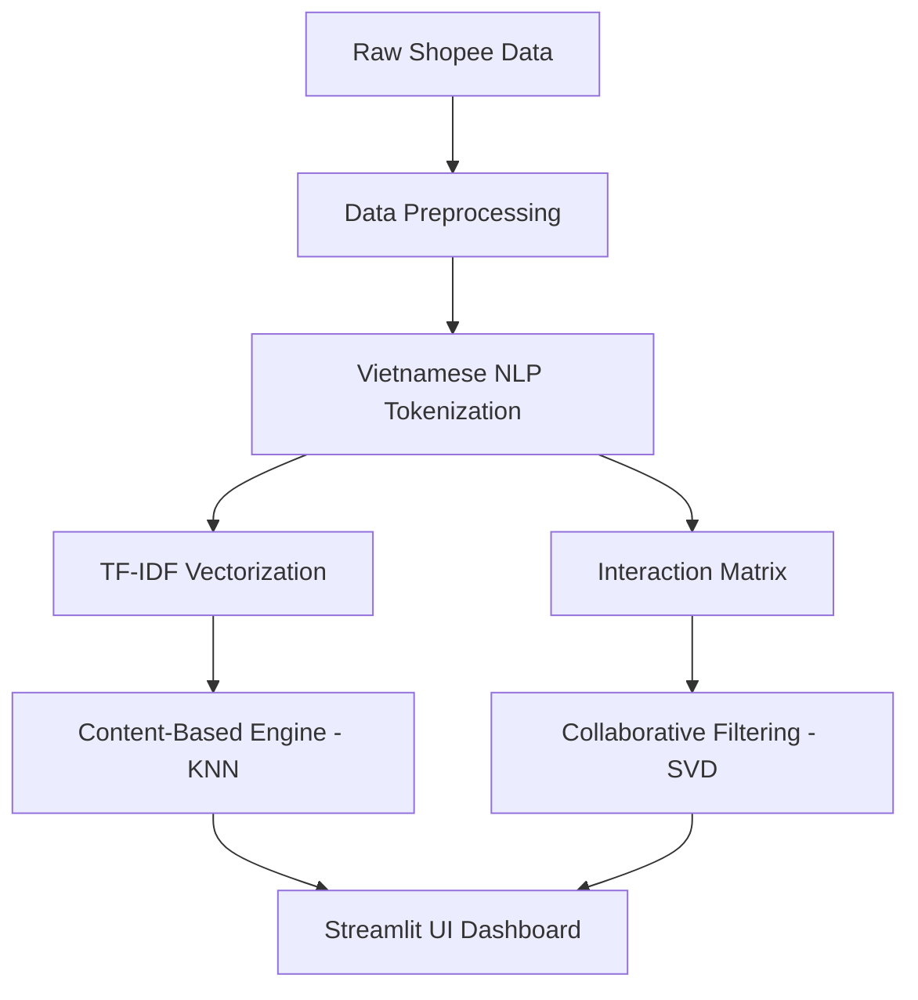

# 🛍️ Shopee Product Recommendation System

[](https://datasciencerecommendsystem-brugej4gzysfaunwurpbxx.streamlit.app/)


A professional end-to-end data science project building a personalized recommendation engine for **Shopee Men's Fashion**. This system leverages both product metadata and user behavioral patterns to deliver high-precision suggestions.

---

## 📖 Table of Contents
- [Project Overview](#-project-overview)
- [Key Features](#-key-features)
- [System Architecture](#-system-architecture)
- [Dataset & Preprocessing](#-dataset--preprocessing)
- [Methodology](#-methodology)
- [Tech Stack](#-tech-stack)
- [Installation & Usage](#-installation--usage)
- [Contact](#-contact)

---

## 🌟 Project Overview
In the competitive e-commerce landscape, personalization is key to user retention and conversion. This project implements a dual-approach recommendation system for Shopee:
1.  **Content-Based Filtering**: Suggests products similar to a target item based on text descriptions and categories.
2.  **Collaborative Filtering**: Recommends items based on historical user-item interactions and rating patterns.

The solution is deployed as an interactive **Streamlit** application supporting both **English and Vietnamese**.

---

## ✨ Key Features
- **Dual Recommendation Engines**: Switch between Content-Based and Collaborative models.
- **Interactive EDA**: Real-time insights into product categories, price distribution, and rating trends.
- **Personalized User Dashboards**: View recommendation results tailored to specific users or products.
- **Multilingual Support**: Fully localized UI in English and Vietnamese.
- **Visual Product Cards**: Dynamic rendering of product images, prices, and ratings directly from the Shopee dataset.

---

## 🏗️ System Architecture



---

## 📊 Dataset & Preprocessing
The system uses the `Products_ThoiTrangNam` dataset, containing thousands of products and user ratings from Shopee.

### Data Cleaning & Feature Engineering:
- **Text Processing**: Used `underthesea` for advanced Vietnamese word segmentation and tokenization.
- **Downsampling**: Handled large-scale data via optimized CSV structures for real-time performance.
- **Handling Sparsity**: Processed user-item matrices for robust collaborative filtering.

---

## 🔬 Methodology

### 1. Content-Based Filtering
- **Vectorization**: TF-IDF (Term Frequency-Inverse Document Frequency) to convert product names and descriptions into numerical vectors.
- **Similarity**: K-Nearest Neighbors (KNN) with Cosine Similarity to find the closest items in the vector space.

### 2. Collaborative Filtering
- **Library**: `SurPRISE` (Simple Python Recommendation System Engine).
- **Algorithm**: SVD (Singular Value Decomposition) to predict missing ratings by latent factor modeling.
- **Evaluation**: Optimized for precision and recall across historical user interactions.

---

## 🛠️ Tech Stack
- **Languages**: Python 3.9+
- **NLP**: `underthesea` (Vietnamese NLP)
- **Machine Learning**: `scikit-learn`, `scikit-surprise`
- **Data Manipulation**: `pandas`, `numpy`, `scipy`
- **Visualization**: `matplotlib`, `seaborn`, `plotly`, `wordcloud`
- **Web Framework**: `Streamlit`

---

## 🚀 Installation & Usage

### 1. Clone the repository
```bash
git clone https://github.com/anatwork14/data_science_recommend_system.git
cd data_science_recommend_system
```

### 2. Install dependencies
```bash
pip install -r requirements.txt
```

### 3. Run the application
```bash
streamlit run main.py
```

---

## 🔗 Deployment
The app is live and can be accessed at:  
👉 **[Shopee Recommend System Live Demo](https://datasciencerecommendsystem-brugej4gzysfaunwurpbxx.streamlit.app/)**

---

## 👥 Authors & Contributors
Developed by:
- **Bùi Khánh An**
- **Trần Thanh Trúc**

Instructed by: **Khuất Thuỳ Phương**

*Project completed in April 2025.*
